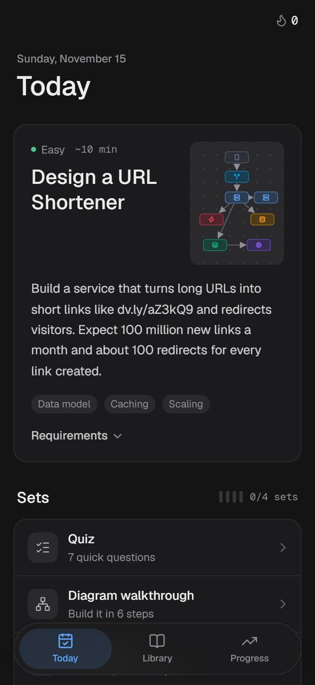
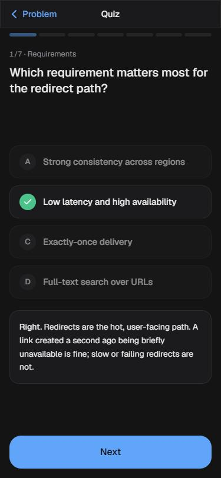
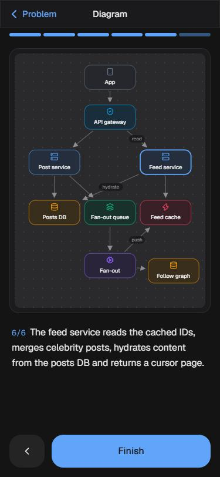

# Devly

One system design problem a day, split into short pieces you can finish in the minutes between sets at the gym.

**Try it:** [devly.zachhersick.com](https://devly.zachhersick.com). Open it on your phone and add it to your home screen. It works offline, with no account.

<p>
  
  
  
</p>

## How a day works

Each problem is broken into four **sets**. Each set takes a minute or two, and it remembers exactly where you stopped, so you can put your phone down mid-question and pick up after your next set.

- **Quiz:** 6–8 multiple-choice questions that follow the shape of a design interview: requirements, estimation, API, data model, high-level design, deep dive, bottlenecks. Every answer explains why.
- **Diagram:** the reference architecture appears one component per tap, each with a one-line reason it's there.
- **Your design:** type or dictate your own answer, then compare it with a model answer and tick off the key points you covered to get a score.
- **Cards:** concept flashcards for the ideas the problem relies on. Cards come back on a spaced-review schedule (1, 3, 7, 14 and 30 days), and ones you miss return the same day.

You get a new problem each day, in order from easier to harder. Problems you've already finished are skipped, and the **Library** lets you work ahead or redo any of them. **Progress** shows your streak and your quiz accuracy by topic, and points out your weakest topic.

## What's inside

60 problems and 109 concept cards, all written for Devly:

- **Easy (14):** URL shortener, rate limiter, pastebin, unique ID generator, leaderboard, feature flags, live polls, webhooks, photo sharing, shared calendar and more
- **Medium (28):** news feed, notifications, typeahead, chat, presence, web crawler, API gateway, ticket booking, checkout, flash sales, single sign-on, log aggregation, metrics and alerting, online code judge and more
- **Hard (18):** video streaming, ride hailing, file sync, payments, distributed key-value store, distributed locks, message queues, object storage, CDN, web search, collaborative docs, maps navigation, stock exchange and more

## Privacy

Devly has no server, no accounts and no analytics. Your answers, drafts, streaks and card reviews are stored only in your browser on your device (IndexedDB). To move them to another device or keep a copy, use **Progress → Export backup** and **Import backup**. Clearing your browser's site data erases your progress.

## Run it locally

Requires Node 20 or newer.

```bash
npm install
npm run dev
```

The app runs at http://localhost:4340.

| Command | What it does |
| --- | --- |
| `npm test` | Logic tests and checks on every problem and card |
| `npm run build` | Production build into `dist/`, including the offline service worker |
| `npm run preview` | Serves the production build on port 4340 |
| `npm run build:icons` | Regenerates the app icons from `assets/icon.svg` |

The service worker is turned off on localhost so you always see fresh code. Add `?sw` to the URL to test offline mode against a production build.

## How it's built

React 19, Vite 8, Tailwind CSS 4, Motion and Preact signals, installable as a PWA through `vite-plugin-pwa`. It's a static site with no backend, deployed on Vercel.

| Path | What's there |
| --- | --- |
| `src/content/problems/` | One file per problem; the number prefix sets the daily order |
| `src/content/cards/` | Concept cards, grouped by topic |
| `src/lib/model.js` | Pure logic: daily pick, streaks, card scheduling, scoring and content validation |
| `src/lib/store.js` | App state on top of IndexedDB |
| `src/pages/` | One file per screen |
| `src/components/diagram-view.tsx` | Draws the architecture diagrams as SVG from data |

## Adding a problem

Copy `src/content/problems/01-url-shortener.js` to a new `NN-<id>.js` file and fill it in. The file name must match the problem's `id`, and every card it lists in `cardIds` must exist in `src/content/cards/`. Then run:

```bash
node --test tests/content.test.js
```

The test checks quiz answers, tags, diagram layout (nodes on the canvas and not overlapping) and card references. No code changes are needed to add a problem. [AGENTS.md](AGENTS.md) has the full content rules.

## License

No license has been chosen yet, so all rights are reserved. You're welcome to read the code and use the app, but please ask before reusing the code or content.
